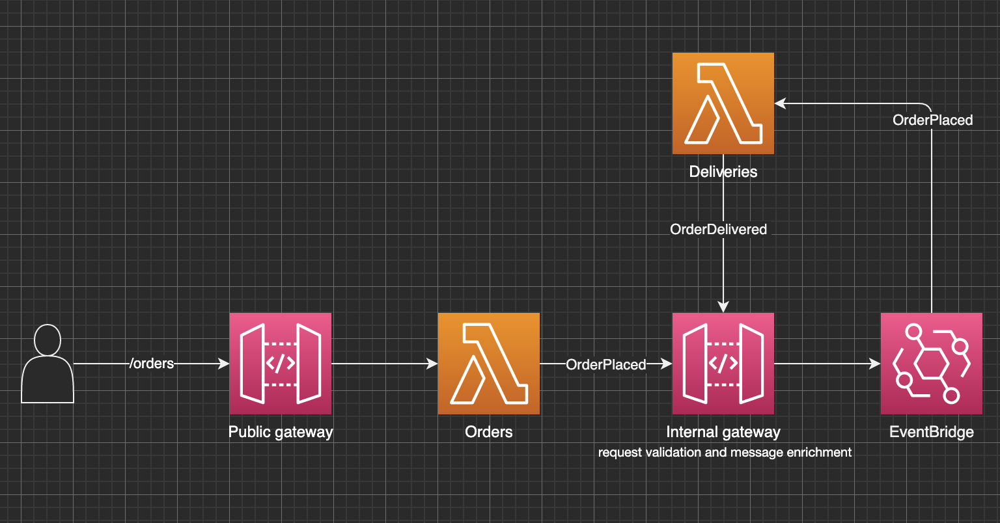

# brew-bar

Event driven order processing app for a brew bar based on AWS services managed via terraform. 

## EDA on AWS

A common and effective approach in event-driven architectures (EDAs) with Bounded Contexts (BCs) is to use one EventBridge custom event bus per bounded context. This design pattern aligns well with the principles of Domain-Driven Design (DDD) and microservices architecture. 
- Each Bounded Context has its own custom event bus for `internal (private) events` and logic. Producers (BCs) publish domain events to their local bus.
- Communication between BCs is explicit, typically using rules to forward specific, well-defined `external (public) events` to a central "core" or "shared" event bus that acts as the enterprise integration point.
- Rules on the local bus can forward relevant events (usually a carefully selected subset of public events, not all internal events) to the central bus.
- Subscribers (other BCs) place a generic rule on the central bus to forward events they are interested in to their own local bus.
- Detailed filtering rules are then applied on the local subscriber bus to trigger specific targets (e.g., Lambda functions, SQS queues). 
This pattern provides the benefits of isolation and autonomy while still enabling cross-context communication in a structured and observable manner. 

## brew-bar architecture

To keep things simple the brew bar solution uses a single event bus for both the Orders and Delivery bounded context.
- Public gateway used for providing public access for placing Orders, can also plug in to an identity provider for authorizing clients/users.
- To enable clients to register events in a consistent, pre established format you can [send client events](https://aws.amazon.com/blogs/compute/capturing-client-events-using-amazon-api-gateway-and-amazon-eventbridge/) to EventBridge via an API Gateway that validates the incoming events for data conformity prior to publishing on Event Bus.
- The internal AWS API Gateway performs validation on published events [using Draft 4 of JSON Schema](https://docs.aws.amazon.com/apigateway/latest/developerguide/models-mappings.html#models-mappings-models). It plugs the schema into an API endpoint in order to reject any requests that don’t conform to the schema.
- The event bus has a rule to dispatch order events to the delivery lambda. You can only create scheduled rules using the default event bus
- EventBridge has a hard limit on the event size at 265 KB



## Build the apps (lambda functions)

The apps are built using `esbuild` and packaged with `zip` as detailed [here](https://docs.aws.amazon.com/lambda/latest/dg/typescript-package.html)

```sh
make build APP=orders
make build APP=delivery
```

## Deploy the stack

The infrastructure and apps are deployed using `terraform`

```sh
# Provision the stack
make stack APPLY=true

# Tear down
make destroy-stack
```

## Get orders

```sh
cd provisioning
curl "$(terraform output -raw orders_api_url)/orders"
```

## Run load tests

- Pre requisites - Install [pipenv](https://packaging.python.org/en/latest/tutorials/managing-dependencies/)

    ```sh
    python3 -m pip install --user pipenv
    ```

- Run load test
  
    ```sh
    # get ORDERS_API_ID by loading terraform output
    make output

    # Terraform out put looks like:
    # orders_api_url = "https://e60e2y07o4.execute-api.eu-west-1.amazonaws.com/brewbar

    # run the load test
    make loadtest ORDERS_API_ID=e60e2y07o4
    ```
